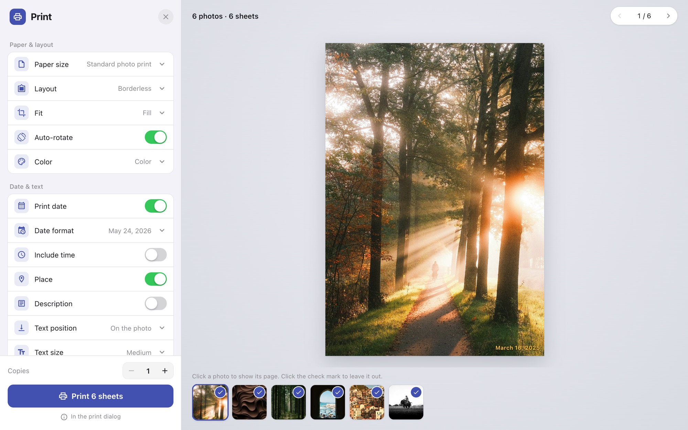
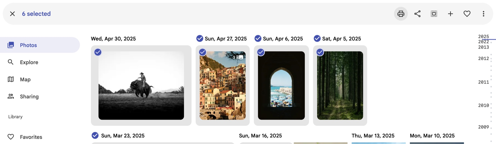
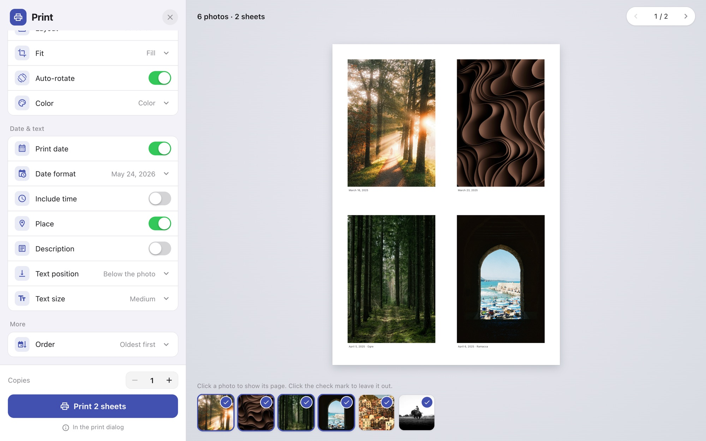
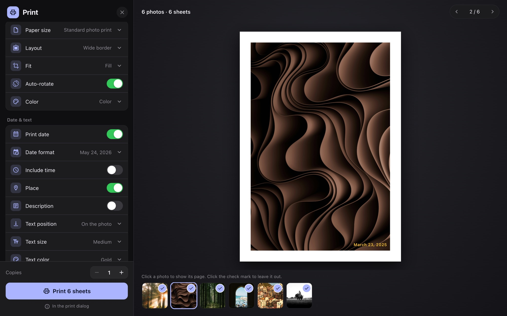
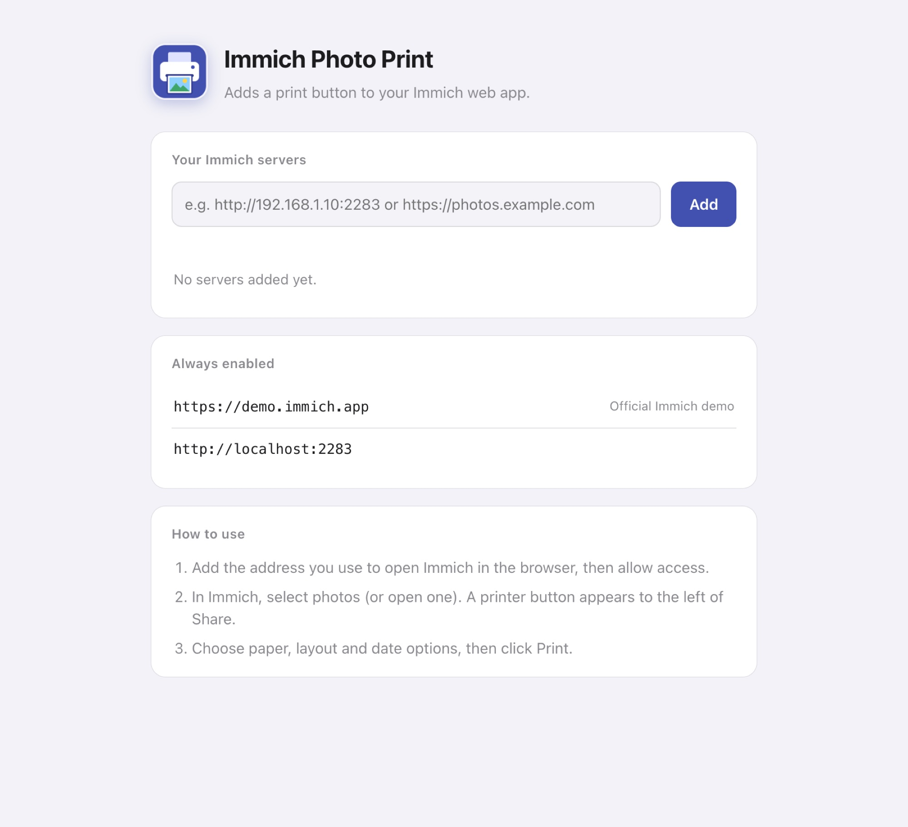

  

<h1 align="center">Immich Photo Print</h1>

  Print photos straight from your <a href="https://immich.app">Immich</a> library — real photo sizes, borderless or bordered, with an optional date stamp.

  <a href="README.zh-CN.md">中文</a> ·
  <a href="https://www.mogai.icu/immich-print/">Website</a> ·
  <a href="https://github.com/gebilaoman/Immich-Photo-Print/releases/latest">Download</a> ·
  <a href="https://demo.immich.app">Try on the Immich demo</a>

  
  
  
  

Immich has no print button. Downloading each photo, opening it in another app and fixing the size every time gets old fast. This extension adds a **Print** button next to **Share** in Immich and opens a print page made for photos.

## Features

- **Fits into Immich.** A printer button appears to the left of **Share**, both when you select photos in the timeline and when you open a single photo. It looks and behaves like the built-in buttons.
- **Real photo paper sizes.** 9 × 13 cm (3.5 × 5"), 10 × 15 cm (4 × 6"), 13 × 18 cm (5 × 7"), 16:9 wide, A6, A5 and A4. The sizes match the paper sizes in common photo-printer drivers exactly, so nothing gets scaled.
- **Several photos per sheet.** On A5 and A4, put 1, 2 or 4 photos on one sheet.
- **Layout.** Borderless, thin white border (3 mm) or wide white border (6 mm). Fill the frame or keep the whole photo. Landscape photos rotate automatically to fill portrait paper.
- **Date stamp.** Print the date taken, optionally with the time, the place and the description. Put the text on the photo, in gold, white or retro orange like a camera date stamp, or in a white strip below the photo.
- **Color or black & white.**
- **Sheet-by-sheet preview.** Page through the sheets. In the filmstrip, click a photo to jump to its sheet, or click its check mark to leave it out.
- **Copies and order.** Print 1–20 copies of each photo, oldest or newest first.
- **Follows Immich.** The language and the light or dark theme follow your Immich settings. Your print settings are remembered.
- **Fast.** Photos load from Immich's preview images (1440 px on the short side), which is plenty for 3.5 × 5" to 5 × 7" prints. Originals are used only for full-page A4 or A5 prints.

## Screenshots

| Print button in Immich | Paper sizes |
|---|---|
|  |  |
| **A4, 4 photos per sheet, date below** | **Dark theme, wide border, gold date** |
|  |  |

## Install

The extension is not in the Chrome Web Store yet. Install it in developer mode:

1. Download `immich-photo-print-<version>.zip` from [Releases](https://github.com/gebilaoman/Immich-Photo-Print/releases/latest) and unzip it. Or clone this repository.
2. Open `chrome://extensions` and turn on **Developer mode** (top right).
3. Click **Load unpacked** and select the unzipped folder.
4. Click the extension icon in the toolbar to open the settings page. Add the address you use to open Immich, for example `http://192.168.1.10:2283` or `https://photos.example.com`, and allow access.

It works in Chrome, Edge and other Chromium browsers. The [Immich demo](https://demo.immich.app) (`demo@immich.app` / `demo`) and `http://localhost:2283` are enabled without setup.

## Usage

1. In Immich, select photos, or open one photo.
2. Click the printer button to the left of **Share**.
3. Choose the paper, layout and date options. The preview on the right updates immediately.
4. Click **Print**. In the print dialog:
   - **Paper size:** the same size as on the print page.
   - **Margins:** None. **Scale:** Default.
   - **Borderless:** click **Print using system dialog** and choose the paper size marked *Borderless* (or *Fullbleed*).
   - **Photo paper:** in the system dialog, set the media type to glossy photo paper and the quality to High. On photo paper, plain-paper mode gives dull colors, banding and smudges.

> A web page cannot choose the printer or the media type, so these settings stay in the print dialog. The **In the print dialog** tip at the bottom of the print page lists them.

## Privacy

- The extension reads photos only from your Immich server, using your logged-in browser session. It never changes anything in Immich.
- It sends nothing anywhere else. There is no analytics and no tracking.
- It runs only on the Immich addresses you add (plus the official demo and `localhost:2283`). Chrome asks for permission for each address.

## Compatibility and limits

- Tested with **Immich v3.4.2**. The button is placed by reading the Immich web page. If a future Immich version changes the page, the button falls back to a floating **Print** button in the lower right, so printing still works.
- Videos are skipped.
- The Immich timeline only keeps photos near the screen in the page. If you **Select all** a large range, photos that never appeared on screen are not included. The print page tells you how many were left out.
- Browser extensions do not run in mobile browsers. On a phone, use **Share → Print** in the Immich app.
- Place names come from Immich's reverse geocoding, which is mostly in English.

## Languages

The text follows the Immich display language (the language you chose in Immich, otherwise your browser language), using the same rules as Immich.

English, Simplified Chinese and Traditional Chinese are included. Other languages show English. To add a language, copy the `en` block in [`i18n.js`](i18n.js) and name it with the Immich language code, for example `ja`, `de` or `fr`. The extension name and the settings page are translated in [`_locales/`](_locales/). Pull requests with translations are welcome.

## Project structure

| File | Purpose |
|---|---|
| `manifest.json` | Extension manifest (Manifest V3) |
| `background.js` | Registers the content scripts for the servers you add |
| `options.html` / `options.js` / `options.css` | Settings page: manage Immich servers |
| `content.js` | Print button, reading the selection, the print page (settings, layout, preview) |
| `content.css` | Print page styles, and the print rules that output only the paper |
| `i18n.js` | Language detection and all print page text |
| `icons.js` | Icons ([Material Design Icons](https://pictogrammers.com/library/mdi/), the same set Immich uses) |
| `_locales/` | Extension name and settings page text |
| `icons/` | Extension icon (`icon.svg` is the source) |

No build step and no dependencies: edit a file, then click the reload button on the extension in `chrome://extensions`.

## License

[GPL-3.0](LICENSE). The icons in `icons.js` are from Material Design Icons (Apache-2.0).

This is an independent project. It is not affiliated with or endorsed by Immich or FUTO.

## More from Mogai Workshop

Small, focused tools by the same author. See them all at **[www.mogai.icu](https://www.mogai.icu/)**.

| Tool | What it does | |
|---|---|---|
| [**Turnout**](https://www.mogai.icu/turnout/) | Chrome extension: switch between local proxy clients (Clash, v2rayN…) in one click, with shared rules | [GitHub](https://github.com/gebilaoman/turnout-proxy) |
| [**Glean**](https://www.mogai.icu/glean/) | Select-to-translate: compare several models side by side, read aloud in one click | [GitHub](https://github.com/gebilaoman/Glean) |
| [**Attune**](https://www.mogai.icu/attune/) | English listening: turn any English text into sentence-by-sentence listening practice | [GitHub](https://github.com/gebilaoman/Attune) |
| [**DirDetective**](https://www.mogai.icu/dirdetective/) | Disk detective: understand every folder before you clean up | [GitHub](https://github.com/gebilaoman/DirDetective) |
| [**cstop**](https://www.mogai.icu/cstop/) | htop-style terminal monitor for Claude Code sessions | [GitHub](https://github.com/gebilaoman/claude-session-monitor) |
| [**mdany**](https://www.mogai.icu/mdany/) | Convert a whole set of Markdown files to PDF or DOCX, with vector diagrams | [GitHub](https://github.com/gebilaoman/mdany) |

If this extension saves you time, a ⭐ on GitHub helps other Immich users find it.
