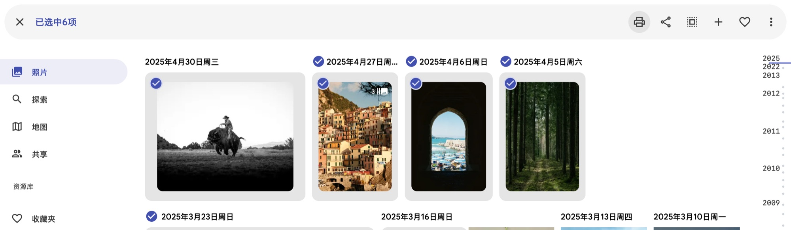
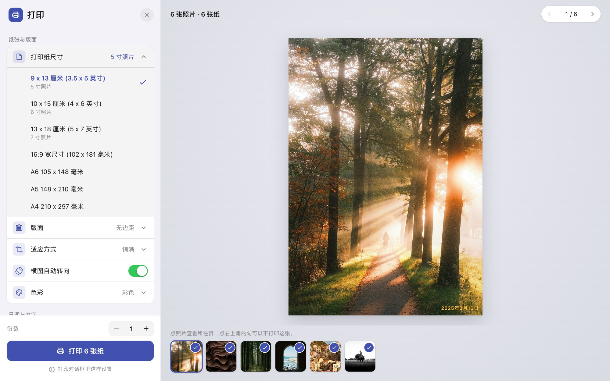
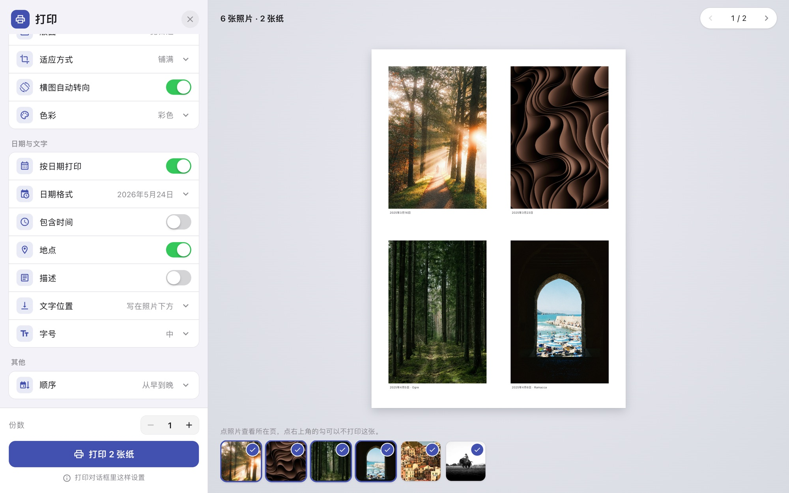
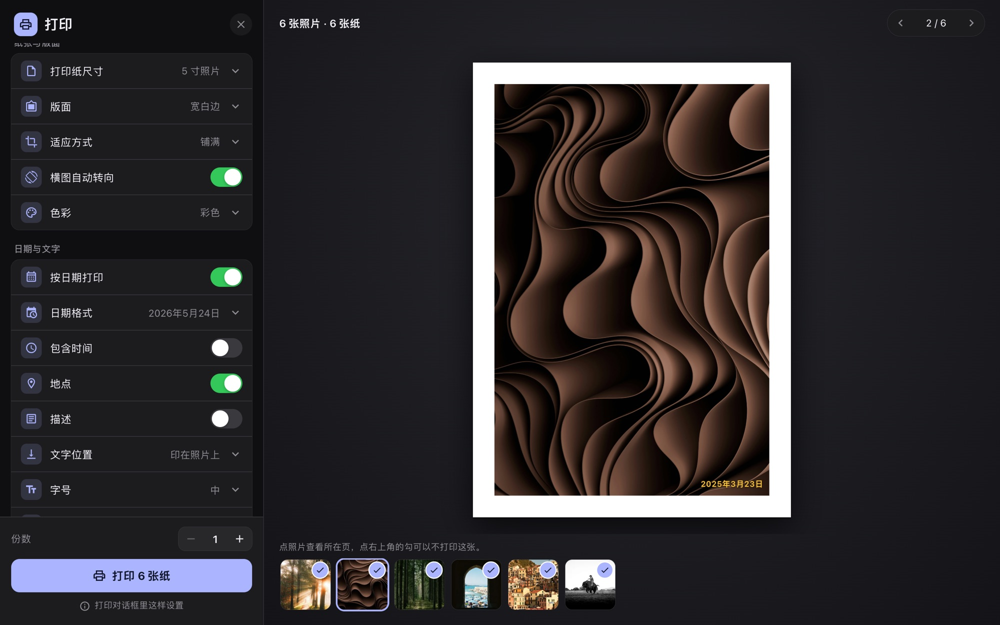
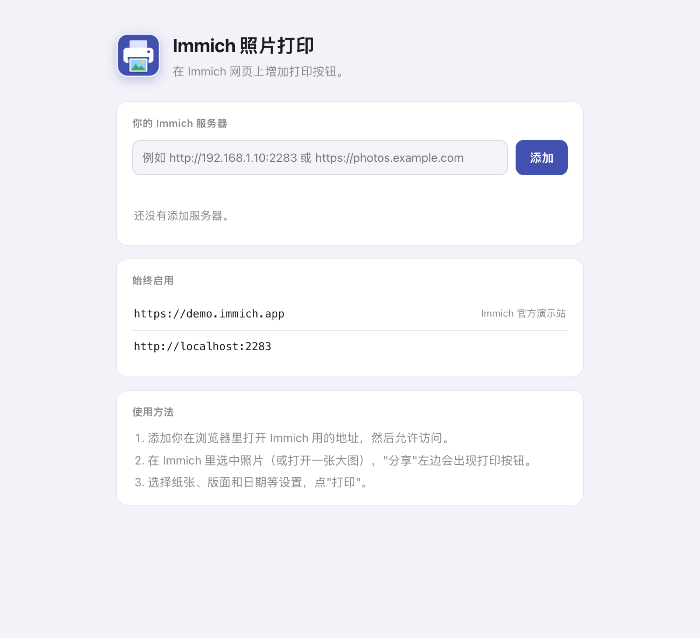

  

<h1 align="center">Immich 照片打印</h1>

  直接从 <a href="https://immich.app">Immich</a> 打印照片：真实的照片纸尺寸，无边距或留白边，可以印上拍摄日期。

  <a href="README.md">English</a> ·
  <a href="https://www.mogai.icu/immich-print/">产品页</a> ·
  <a href="https://github.com/gebilaoman/Immich-Photo-Print/releases/latest">下载</a> ·
  <a href="https://demo.immich.app">在 Immich 演示站试用</a>

  
  
  
  

Immich 没有打印按钮。每次都要先下载照片、换个软件打开、再调尺寸，很麻烦。这个插件在 Immich 的"分享"按钮旁边加一个**打印**按钮，点开就是专门为照片设计的打印页。

## 功能

- **融入 Immich**：在时间线里选中照片，或打开一张大图，"分享"左边都会出现打印机按钮，样式和原生按钮一致。
- **真实的照片纸尺寸**：9×13 厘米（5 寸）、10×15 厘米（6 寸）、13×18 厘米（7 寸）、16:9 宽尺寸、A6、A5、A4。尺寸与常见照片打印机驱动的纸张尺寸完全一致，打印时不会被缩放。
- **一张纸印多张**：A5、A4 可以一张纸印 1、2 或 4 张照片。
- **版面**：无边距、窄白边（3 毫米）、宽白边（6 毫米）；铺满画面或保留完整照片；横拍的照片自动转向，铺满竖向的纸。
- **按日期打印**：印上拍摄日期，可加时间、地点和描述。文字可以印在照片右下角（金黄、白色或复古橙，像相机的日期水印），也可以写在照片下方的白边里。
- **彩色或黑白。**
- **逐页预览**：翻页查看每张纸；底部照片条里点照片跳到它所在的页，点右上角的勾可以不打印这张。
- **份数和顺序**：每张照片打印 1–20 份，按拍摄时间从早到晚或从晚到早排列。
- **跟随 Immich**：语言、浅色/深色主题都跟随 Immich 的设置；打印设置会被记住。
- **打开快**：用 Immich 生成的预览图（短边 1440 像素），5 寸到 7 寸都足够清晰。只有 A4、A5 整页打印一张时才用原图。

## 截图

| Immich 里的打印按钮 | 纸张尺寸 |
|---|---|
|  |  |
| **A4 一张纸印 4 张，日期写在下方** | **深色主题，宽白边，金黄色日期** |
|  |  |

## 安装

插件暂未上架 Chrome 应用商店，用开发者模式安装：

1. 从 [Releases](https://github.com/gebilaoman/Immich-Photo-Print/releases/latest) 下载 `immich-photo-print-<版本>.zip` 并解压；也可以直接克隆本仓库。
2. 打开 `chrome://extensions`，打开右上角的"开发者模式"。
3. 点"加载已解压的扩展程序"，选择解压后的文件夹。
4. 点工具栏上的插件图标，打开设置页。添加你在浏览器里打开 Immich 用的地址，例如 `http://192.168.1.10:2283` 或 `https://photos.example.com`，然后允许访问。

支持 Chrome、Edge 等 Chromium 内核浏览器。[Immich 官方演示站](https://demo.immich.app)（账号 `demo@immich.app`，密码 `demo`）和 `http://localhost:2283` 无需设置，直接可用。

## 使用

1. 在 Immich 里选中照片，或打开一张大图。
2. 点"分享"左边的打印机按钮。
3. 选择纸张、版面和日期等设置，右边的预览会立即更新。
4. 点"打印"。在打印对话框里：
   - **纸张尺寸**：与打印页上选的一致。
   - **边距**：无；**缩放**：默认。
   - **无边距**：点"使用系统对话框进行打印"，纸张尺寸选带"无边距"（或 Fullbleed）的那一项。
   - **照片纸**：在系统对话框的打印设置里，介质类型选光泽照片纸，打印质量选高。用普通纸模式打相纸，颜色会发灰，还会出现横纹和蹭花。

> 网页无法选择打印机和介质类型，这些只能在打印对话框里设置。打印页底部的"打印对话框里这样设置"会列出这些步骤。

## 隐私

- 插件只用你在浏览器里的登录状态，从你自己的 Immich 服务器读取照片，不修改 Immich 里的任何内容。
- 不向任何其他地方发送数据，没有统计，没有追踪。
- 只在你添加的 Immich 地址上运行（另加官方演示站和 `localhost:2283`），每个地址 Chrome 都会单独询问你是否授权。

## 兼容性和限制

- 已在 **Immich v3.4.2** 上测试。按钮的位置是通过读取 Immich 网页结构确定的。如果以后 Immich 改了网页，按钮会退回页面右下角的浮动"打印"按钮，打印功能照样可用。
- 视频会被跳过。
- Immich 的时间线只在页面里保留屏幕附近的照片。用"全选"一次选很多时，没在屏幕上出现过的照片不会被打印，打印页会提示少了几张。
- 手机浏览器不支持插件。手机上请在 Immich App 里用"分享 → 打印"。
- 地点名称来自 Immich 的反向地理编码，多数是英文。

## 多语言

插件文字跟随 Immich 的界面语言（先看你在 Immich 里选的语言，没选过就按浏览器语言），判断规则与 Immich 一致。

已内置英文、简体中文、繁体中文，其他语言显示英文。加一种语言：复制 [`i18n.js`](i18n.js) 里 `en` 那一组，键名用 Immich 的语言代码（如 `ja`、`de`、`fr`），逐项翻译即可。插件名称和设置页的文字在 [`_locales/`](_locales/) 里。欢迎提交翻译的 Pull Request。

## 项目结构

| 文件 | 作用 |
|---|---|
| `manifest.json` | 插件配置（Manifest V3） |
| `background.js` | 为你添加的服务器注册内容脚本 |
| `options.html` / `options.js` / `options.css` | 设置页：管理 Immich 服务器 |
| `content.js` | 打印按钮、读取选中的照片、打印页（设置、排版、预览） |
| `content.css` | 打印页样式，以及打印时只输出纸张的规则 |
| `i18n.js` | 语言判断和打印页的全部文字 |
| `icons.js` | 图标（[Material Design Icons](https://pictogrammers.com/library/mdi/)，与 Immich 用的是同一套） |
| `_locales/` | 插件名称和设置页的翻译 |
| `icons/` | 插件图标（`icon.svg` 是源文件） |

没有构建步骤，也没有依赖：改完文件，在 `chrome://extensions` 里点插件的刷新按钮即可。

## 许可证

[GPL-3.0](LICENSE)。`icons.js` 中的图标来自 Material Design Icons（Apache-2.0）。

本项目为独立项目，与 Immich 及 FUTO 无关，未获其认可。

## 魔改虾的其他工具

同一作者做的小而专的工具，全部在 **[www.mogai.icu](https://www.mogai.icu/)**。

| 工具 | 用途 | |
|---|---|---|
| [**Turnout**](https://www.mogai.icu/turnout/) | Chrome 扩展：多个代理客户端一键切换模式与出口，规则配一次全局生效 | [GitHub](https://github.com/gebilaoman/turnout-proxy) |
| [**Glean**](https://www.mogai.icu/glean/) | 划词翻译：多个模型并排对比，一键朗读 | [GitHub](https://github.com/gebilaoman/Glean) |
| [**Attune**](https://www.mogai.icu/attune/) | 英语听读：把英文变成逐句精听的听力材料 | [GitHub](https://github.com/gebilaoman/Attune) |
| [**DirDetective**](https://www.mogai.icu/dirdetective/) | 磁盘目录侦探：清理之前，先看懂每个文件夹 | [GitHub](https://github.com/gebilaoman/DirDetective) |
| [**cstop**](https://www.mogai.icu/cstop/) | Claude Code 会话监控：htop 风格的终端界面 | [GitHub](https://github.com/gebilaoman/claude-session-monitor) |
| [**mdany**](https://www.mogai.icu/mdany/) | 整套 Markdown 一条命令转 PDF / Word，流程图出矢量图 | [GitHub](https://github.com/gebilaoman/mdany) |

如果这个插件帮你省了时间，在 GitHub 上点个 ⭐，能让更多 Immich 用户找到它。
